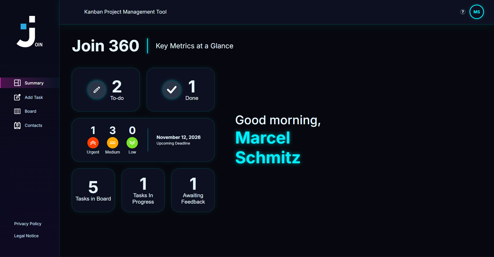
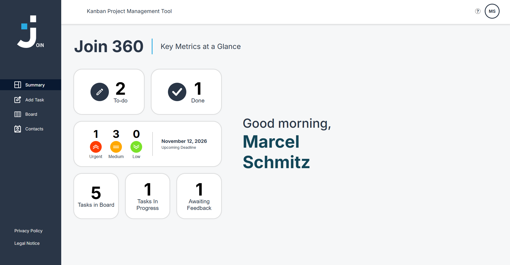
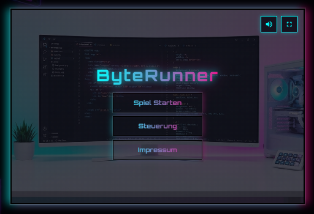

# Marcel Schmitz – Portfolio

Persönliches Portfolio von **Marcel Schmitz** (Frontend-Entwickler, Weiterbildung zum Full-Stack-KI-Entwickler an der Developer Akademie). Die Seite ist zweisprachig (Deutsch / Englisch), responsive bis 320 px und stellt meine Projekte, Fähigkeiten und Kontaktmöglichkeiten vor.

**Live:** [mschmitz-dev.de](https://mschmitz-dev.de)

| Projekt | Live | Beschreibung |
| --- | --- | --- |
| ByteRunner | [byterunner.mschmitz-dev.de](https://byterunner.mschmitz-dev.de) | 2D-Jump-and-Run in nativem JavaScript |
| Join | [join.mschmitz-dev.de](https://join.mschmitz-dev.de) | Kanban-Task-Manager (Gruppenprojekt) |

## Inhalt der Seite

- **Hero** mit Social-Links (GitHub, LinkedIn, E-Mail)
- **Why me** – kurze Vorstellung und Standort
- **My Skills** – Technologien und aktuelle Lernthemen
- **My Projects** – ByteRunner und Join mit Beschreibung, Technologien, Live-Test und GitHub-Link
- **Need a teamplayer?** – Stimmen aus dem Join-Team
- **Contact me** – Kontaktformular mit Validierung und Datenschutz-Checkbox
- **Impressum** (`/legal-notice`) und **Datenschutzerklärung** (`/privacy-policy`)

## Projektvorschau

### Join (Dark Mode und Light Mode)





### ByteRunner



## Technologien

- **Angular 22** mit Standalone Components
- **TypeScript** und **SCSS**
- **Reactive Forms** mit eigenen Validatoren (Name, E-Mail, Nachricht)
- **Angular SSR / Prerendering** – die drei Routen werden beim Build statisch erzeugt
- **PHP** (`public/sendMail.php`) für den Mailversand des Kontaktformulars
- Hosting bei **IONOS**

## Architektur

```
src/app/
├── features/
│   ├── home/            Startseite, setzt alle Sektionen zusammen
│   ├── why-me/
│   ├── skills/
│   ├── projects/        Projektdaten und Tabs (DE/EN)
│   ├── teamplayer/
│   ├── contact-me/      Formular, Validatoren, Versand
│   ├── legal-notice/    Impressum
│   └── privacy-policy/  Datenschutzerklärung
├── shared/
│   ├── components/      header, footer
│   └── services/        language.service.ts (DE/EN)
public/
├── assets/              Bilder und Icons
├── sendMail.php         Mail-Endpunkt
└── .htaccess            HTTPS-Redirect und Routing-Fallback
```

Die Sprache wird zentral im `LanguageService` gehalten. Beim Umschalten wird auch das `lang`-Attribut des `<html>`-Elements angepasst. Alle Texte liegen als `de`/`en`-Objekte in den jeweiligen Komponenten.

## Lokal starten

Voraussetzung: Node.js und npm.

```bash
npm install
npm start
```

Die Seite läuft dann unter `http://localhost:4200/`. Das Kontaktformular sendet lokal keine Mails, weil der Angular-Entwicklungsserver kein PHP ausführt.

## Build

```bash
npm run build
```

Der Output liegt in `dist/marcel-schmitz-portfolio/browser/`. Für das Hosting wird nur der **Inhalt dieses Ordners** benötigt (der Ordner `server/` nicht). Die Datei `.htaccess` muss im Webroot mit hochgeladen werden.

## Kontaktformular einrichten

Das Formular sendet per `POST` JSON an `/sendMail.php`. In `public/sendMail.php` müssen oben drei Werte gesetzt werden:

```php
$fromEmail = 'kontakt@mschmitz-dev.de';   // Postfach auf der eigenen Domain
$toEmail   = 'deine-adresse@example.com'; // Empfänger der Nachrichten
$allowedOrigins = ['https://mschmitz-dev.de', 'https://www.mschmitz-dev.de'];
```

Das Skript prüft die Eingaben serverseitig, verhindert Header-Injection, begrenzt die Längen und erlaubt Anfragen nur von den eingetragenen Origins.

## Deployment (IONOS)

1. `npm run build`
2. Inhalt von `dist/marcel-schmitz-portfolio/browser/` ins Webroot der Domain hochladen (inklusive `.htaccess` und `sendMail.php`)
3. Direktaufrufe von `/legal-notice` und `/privacy-policy` sowie das Kontaktformular testen

## Datenschutz

- keine Cookies, keine Tracking- oder Analyse-Tools
- Hosting und Mailversand über IONOS (Auftragsverarbeitungsvertrag vorhanden)
- das Projekt Join nutzt Supabase als Datenbank (Auftragsverarbeitungsvertrag vorhanden)
- Schriftarten werden von Google Fonts geladen

Details stehen in der Datenschutzerklärung der Seite.

## Autor

**Marcel Schmitz** · [GitHub](https://github.com/marcel-schmitz-dev) · [LinkedIn](https://www.linkedin.com/in/marcel-schmitz-4bb060447/)
